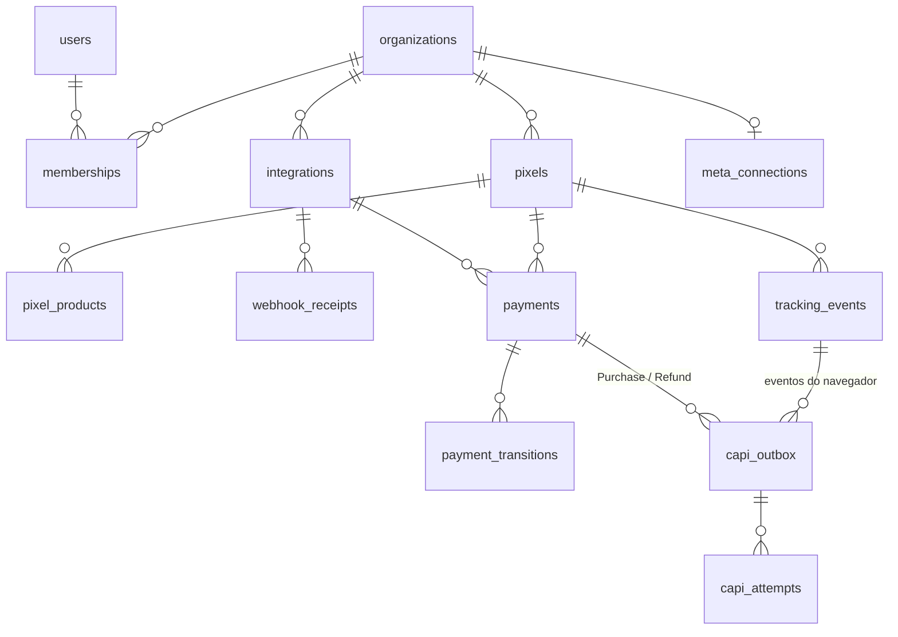

# Modelo de dados (PostgreSQL 16)

Fonte: `packages/db/migrations/001_init.sql`. Regras gerais:

- Toda tabela de dados de cliente tem `org_id`, e toda consulta da API filtra por ele (testado em `security.test.ts`).
- Dinheiro: `*_minor bigint` + `currency char(3)`. Nunca `float` nem `decimal` sem moeda.
- Datas: `timestamptz` (UTC). O dia local é calculado na consulta com o fuso da organização.
- Segredos: colunas `*_enc` com AES-256-GCM (`v1.<iv>.<tag>.<dados>`); tokens de acesso guardados só como `sha256`.
- Colunas `legacy_*` ligam cada linha à de origem no MySQL antigo (importação idempotente).

## Contas e acesso

| Tabela | Para quê | Restrições importantes |
|---|---|---|
| `users` | Pessoa que entra no painel | `email` único (citext); `password_hash` bcrypt |
| `sessions` | Sessões ativas | PK = sha256 do token do cookie; `expires_at` deslizante; `revoked_at` |
| `auth_tokens` | Links de redefinir senha e confirmar e-mail | `token_hash` único; uso único (`used_at`) |
| `rate_limits` | Contadores de tentativa por IP e por e-mail | janela por `bucket` |
| `organizations` | Cliente do SaaS (tenant) | moeda de relatório, fuso, metas, plano |
| `memberships` | Usuário × organização com papel | PK `(org_id, user_id)`; papel owner/admin/analyst/viewer |
| `invitations` | Convites pendentes | aceitos só pelo e-mail convidado |
| `audit_log` | Quem alterou o quê | escrito pelas rotas de configuração |

## Configuração de rastreamento

| Tabela | Para quê | Restrições importantes |
|---|---|---|
| `pixels` | Pixel da Meta + token CAPI cifrado | `public_key` única (vai no navegador e não é segredo); `meta_pixel_id` só dígitos |
| `pixel_products` | Produto → pixel, para rotear a venda | PK `(org_id, product_id)`: um produto pertence a **um** pixel por organização |
| `integrations` | Gateway conectado | único `(token_hash, provider)`; `amount_unit` major/minor declarado; `secret_enc` |
| `meta_connections` | OAuth do Meta Ads (leitura de gasto, gestão de campanhas) | uma por organização; token cifrado; moeda da conta |
| `oauth_states` | `state` do OAuth com validade | protege o callback contra CSRF |

## Recebimento e pagamentos

| Tabela | Para quê | Restrições importantes |
|---|---|---|
| `webhook_receipts` | Toda chamada recebida, com resultado e motivo | único `(integration_id, idempotency_key)` em processados: o mesmo evento não é processado duas vezes; corpo cifrado com retenção |
| `payments` | Uma linha por transação do gateway; **fonte da verdade das métricas** | único `(org_id, provider, transaction_id)`; status pending/approved/refunded/chargeback/canceled/failed; datas de cada etapa |
| `payment_transitions` | Histórico de mudanças de status | ligada ao recebimento que causou a mudança |

## Eventos e entrega à Meta

| Tabela | Para quê | Restrições importantes |
|---|---|---|
| `tracking_events` | Eventos do navegador (PageView, InitiateCheckout…) e do servidor | único `(pixel_id, event_name, event_id)`: beacon + fetch repetidos viram um |
| `visitor_identities` | Ponte navegador → venda (fbp, fbc, UTM, IP, user agent) por `external_id` | PK `(org_id, xid)`; busca por e-mail/telefone hasheados só para quem passou pelo checkout |
| `capi_outbox` | Fila transacional de envio à Conversions API | único `(pixel_id, event_name, event_id)`; status pending/sending/sent/dead; `events_received` da resposta |
| `capi_attempts` | Cada tentativa de envio | HTTP, duração, classe do erro, `fbtrace_id` |

O evento entra na fila **na mesma transação** que grava a venda. Se a transação falha, nenhum dos
dois existe; se ela confirma, o envio é garantido (com novas tentativas) ou vira alerta.

## Apoio

| Tabela | Para quê |
|---|---|
| `fx_rates` | Cotações diárias (base EUR) com fonte; PK `(rate_date, base, quote)` |
| `meta_insights_cache` | Cache curto das respostas de Insights da Meta |
| `billing_charges` | Cobranças PIX da assinatura (Woovi); `correlation_id` único torna o webhook idempotente |
| `push_subscriptions` | Inscrições de Web Push por usuário |
| `alerts` | Alertas operacionais; um aberto por `dedup_key` |
| `schema_migrations` | Migrações aplicadas (criada pelo `migrate`) |

## Mudanças de schema

Novas migrações: `packages/db/migrations/NNN_descricao.sql`, só aditivas. Veja a política em
`docs/DEPLOY.md` §4.
